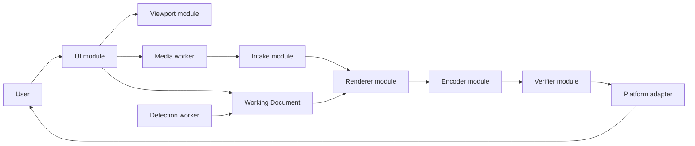

# Architecture

Status: proposed and partially scaffolded

## Goals

- Concentrate privacy-critical behaviour in a small number of deep modules.
- Keep Source Media bytes and full-resolution pixels out of the UI module.
- Make the same interfaces the caller and test surfaces.
- Add seams only where behaviour actually varies.
- Fail closed when intake, rendering, encoding, or verification is uncertain.

## Runtime model

The initial release excludes the Detection worker. It is shown to preserve its intended relationship: it produces Suggested Regions and cannot produce Confirmed Redactions.

## Deep modules

### Intake module

The Intake module owns the entire transition from untrusted local file to normalized media state:

- magic-byte and container validation;
- file-size, dimension, pixel-count, and frame-count limits;
- metadata risk classification;
- EXIF orientation normalization;
- color-space policy;
- decoding and failure handling; and
- transfer of normalized pixels to the renderer.

Metadata inspection is advisory. Intake failure never causes source container segments to be copied into output.

The pre-decode controls are implemented behind the framework-independent `inspectSourceMedia` interface in `src/intake/source-media.ts`. It scans the complete JPEG marker stream, validates magic bytes and a single complete frame, rejects trailing or concatenated data, reads EXIF orientation, and enforces provisional byte, dimension, and pixel budgets. `src/intake/jpeg-metadata.ts` adds bounded advisory classification for selected EXIF/GPS, XMP, IPTC, JPEG comment, embedded-thumbnail, and C2PA/JUMBF risks; recognized parser failures, truncated values, and exceeded metadata budgets produce a `partial` summary without making pixel intake depend on successful metadata interpretation.

The browser intake and render path is implemented through the versioned, runtime-validated protocol in `src/workers/media-worker-protocol.ts`. Protocol version 2 binds render requests to worker-issued source identifiers and rejects unknown response fields so full-resolution pixels cannot accidentally cross the UI boundary. The UI clears the file input; the client checks `File.size` before allocation, reads the selected `File` once, and transfers its `ArrayBuffer` to an inline-bundled dedicated worker without a data URL or HTTP(S) request. The worker runs preflight before `createImageBitmap`, neutralizes APP1 metadata only in a decode-specific copy, verifies that the decoder returns encoded dimensions, and applies the validated orientation itself before retaining normalized full-resolution pixels in an opaque sRGB `OffscreenCanvas`. Only the inspection result and previews bounded to 512 pixels per axis cross back to the UI. Intake, decode, and render errors are typed; unexpected protocol values, semantically mismatched render dimensions, and operation deadlines fail the worker session. Reset clears preview and canonical derivative state, asks the worker to clear its canvas, terminates it, and creates a fresh inline worker. Browser tests cover orientations 1–8 and expected corner order, hostile text rendering, malformed input and decoder failure, reduced and redacted preview pixels, stale preview replacement, no user-media persistence, no HTTP(S) requests after selection, and startup under the production CSP/Trusted Types policy. Measured device budgets, complete decoder color-conversion evidence, deadline calibration, and non-Chromium real-device evidence remain open.

### Working Document module

The Working Document owns transforms, Confirmed Redactions, operation ordering, and undo/redo. Geometry is represented as normalized canonical document coordinates rather than viewport pixels. `src/document/working-document.ts` now records explicit source dimensions and applies framework-independent add, update, and remove commands to ordered rectangle operations. Undo and redo move through that operation history, a new command discards an abandoned redo branch, and unchanged updates do not create misleading history entries. `src/document/redaction.ts` enforces finite in-bounds coordinates, non-zero area, and a fully opaque RGB color; its move and bottom-right resize operations clamp geometry to the document boundary and a caller-supplied minimum size. The Working Document additionally rejects rectangles smaller than one canonical source pixel per axis. The first UI slice intentionally exposes only one editable rectangle.

### Renderer module

The framework-independent Renderer in `src/renderer/canonical-renderer.ts` runtime-validates a narrow Working Document snapshot and creates a frozen, trusted render plan. ADR-0008 defines conservative half-open coverage: normalized starts are floored and ends are ceiled to canonical integer bounds without an inward epsilon. The Renderer rejects malformed dimensions, geometry, identifiers, status, kind, color, opacity, duplicate identifiers, transparency, partial RGBA views, excessive operations, and excessive rasterization work. It writes exact opaque RGB bytes in Working Document order into a dedicated canonical RGBA buffer without mutating retained normalized Source Media pixels.

The media worker owns both rendering modes. It extracts a fresh full-resolution derivative from its retained opaque sRGB `OffscreenCanvas`, applies the canonical plan, wipes the temporary extraction, and retains the latest canonical RGBA output for later Sanitizer integration. It independently draws Source Media into a bounded derivative preview and maps canonical integer masks outward to preview pixels. Only that `ImageBitmap`, preview dimensions, and canonical dimension facts cross to the UI; canonical RGBA bytes remain worker-owned. Source identifiers, request ordering, client-side stale-result disposal, and dimension checks fail closed on new-source and stale-render races. Reset and replacement render operations overwrite the retained canonical derivative on a best-effort basis.

The current application displays worker-rendered rectangle previews, but it does not expose export, download, or share. Full-resolution memory/latency calibration, render coalescing, non-Chromium OffscreenCanvas evidence, future transform ordering, decoder color conversion, and transparent-input flattening remain open. A measured fallback may be added only if a second adapter is required.

### Sanitizer module

The Sanitizer coordinates export rendering and fresh encoding. It does not copy source file segments, metadata, thumbnails, or profiles. Format adapters are introduced only when two encoders are actually supported.

The standalone PNG foundation is implemented in `src/encoder/png-encoder.ts` and `src/sanitizer/png-sanitizer.ts`. The encoder accepts only a dedicated dimension-matched RGBA8 rendered-pixel buffer with alpha 255 everywhere, transfers ownership away from its caller, and creates a strict opaque RGB8 non-interlaced PNG with exactly one `IHDR`, one `IDAT`, and one `IEND`. The Sanitizer returns an immutable branded `Blob` only after verification succeeds. Canonical rendering now exists, but these modules are deliberately not connected to the media worker, UI, or download path until worker-owned output and independently derived mask policy are integrated behind one fail-closed operation.

### Verifier module

The Verifier treats encoded output as untrusted. It checks:

- container structure and declared format;
- dimensions and frame count;
- a strict metadata allowlist;
- absence of EXIF, GPS, XMP, IPTC, comments, thumbnails, source color profiles, and C2PA/JUMBF data; and
- coverage of Confirmed Redactions after final encoding.

`src/verifier/png-verifier.ts` now implements this policy for the deliberately narrow PNG profile. It snapshots mutable input, independently validates framing and CRCs, rejects every non-core chunk, bounds decompression to the exact expected RGB8 scanline length, checks canonical dimensions, structurally rejects alpha, and verifies required integer mask regions for exact RGB. `src/verifier/working-document-policy.ts` now independently validates normalized Working Document mask state and derives conservative integer required regions without importing Renderer rasterization code. Ordered overlaps are reduced to non-overlapping final-visible regions so exact-color verification matches final compositing; excessive fragmentation fails closed. Canonical worker rendering is not yet connected to PNG encoding or runtime verification, so no output Blob or platform capability is exposed.

The Verifier does not claim that every Sensitive Region was found. A failed or inconclusive check blocks Sanitizer output. Save and share remain absent rather than exposing a path around the unintegrated verifier.

### Viewport module

The Viewport owns Pointer Events, pointer capture, keyboard input, pan, zoom, brush preview, and coordinate conversion. `src/viewport/coordinates.ts` now converts CSS-scaled pointer positions into bounded normalized document points. The React-edge rectangle editor uses pointer capture for draw, move, and resize, and provides keyboard add, one-source-pixel move/resize, remove, undo, and redo paths. Viewport zoom and pan remain unimplemented; when added, they must not change Working Document or export dimensions without an explicit Transform.

### Detection module

Post-v1 automation runs in a separate worker on a reduced-resolution, metadata-free image. It returns Suggested Regions only. The module stores no embeddings and performs no recognition or identity matching.

### Platform module

A real seam exists between two output adapters:

- file download; and
- native file sharing where the browser supports it.

File System Access may become a third progressive adapter. Unsupported capabilities remain absent rather than polyfilled through a backend.

## Data lifecycle

1. The UI receives a user-selected File.
2. The client checks `File.size`, reads the File once, and transfers its `ArrayBuffer` to the media worker without conversion to a data URL.
3. Intake validates the container and resource budget before full decode.
4. Untrusted metadata is reduced to a plain-text Metadata Risk Summary.
5. The media worker owns normalized full-resolution pixels.
6. The UI receives only preview frames and document state.
7. The user creates Confirmed Redactions through canonical Working Document operations; explicit image transforms remain planned.
8. The media worker renders and retains a fresh full-resolution RGBA derivative while returning only a bounded redacted preview.
9. A future worker integration will transfer ownership of that derivative to the encoder, which creates a new container without source segments.
10. The Verifier inspects the final bytes and rendered masks.
11. A verified Blob crosses to a Platform adapter after user activation.
12. Session cleanup revokes object URLs, closes bitmaps, detaches or overwrites buffers where practical, and terminates workers.

Cleanup is best effort because browser and operating-system copies cannot be proven erased.

## Dependency direction

- UI depends on Working Document and typed worker messages.
- Viewport depends on Working Document geometry, not on rendering internals.
- Intake, Renderer, Sanitizer, and Verifier live behind the media-worker seam.
- Detection depends only on reduced normalized pixels and returns suggestions.
- Platform adapters receive only a verified output Blob and safe filename.
- Privacy-critical modules never depend on React.

## Error strategy

Errors are typed by stage: intake, resource limit, decode, render, encode, verify, and platform handoff. Unknown errors become terminal failures for the current operation. Privacy Export never falls back to an unverified path.

## Persistence

Application assets may be cached for offline execution. Source Media, decoded pixels, previews, Working Documents, metadata values, and Privacy Exports are not written to Cache Storage, IndexedDB, local storage, or session storage by v1.

## Deployment

The production application is a static build hosted over HTTPS on infrastructure capable of custom response headers. Production headers are represented by `public/_headers`. Runtime assets are same-origin and bundled. The inline media worker uses a same-origin blob URL under `worker-src 'self' blob:`; `src/security/trusted-types.ts` installs a default Trusted Types policy that can create only same-origin blob script URLs and cannot create HTML or script text. A browser test loads the application under the production policy and proves other worker URL shapes and string-based HTML sinks are rejected. `connect-src 'none'` remains in force; any future requirement to relax it requires an ADR and explicit threat-model review.
