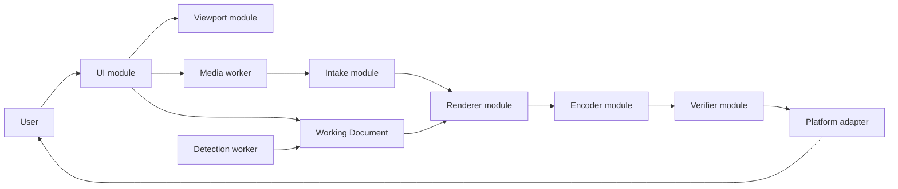

# Architecture

Status: proposed and partially scaffolded

## Goals

- Concentrate privacy-critical behaviour in a small number of deep modules.
- Keep Source Media bytes and full-resolution pixels out of the UI module.
- Make the same interfaces the caller and test surfaces.
- Add seams only where behaviour actually varies.
- Fail closed when intake, rendering, encoding, or verification is uncertain.

## Runtime model

The initial release excludes the Detection worker. It is shown to preserve its intended relationship: it produces Suggested Regions and cannot produce Confirmed Redactions.

## Deep modules

### Intake module

The Intake module owns the entire transition from untrusted local file to normalized media state:

- magic-byte and container validation;
- file-size, dimension, pixel-count, and frame-count limits;
- metadata risk classification;
- EXIF orientation normalization;
- color-space policy;
- decoding and failure handling; and
- transfer of normalized pixels to the renderer.

Metadata inspection is advisory. Intake failure never causes source container segments to be copied into output.

The pre-decode controls are implemented behind the framework-independent `inspectSourceMedia` interface in `src/intake/source-media.ts`. It scans the complete JPEG marker stream, validates magic bytes and a single complete frame, rejects trailing or concatenated data, reads EXIF orientation, and enforces provisional byte, dimension, and pixel budgets. `src/intake/jpeg-metadata.ts` adds bounded advisory classification for selected EXIF/GPS, XMP, IPTC, JPEG comment, embedded-thumbnail, and C2PA/JUMBF risks; recognized parser failures, truncated values, and exceeded metadata budgets produce a `partial` summary without making pixel intake depend on successful metadata interpretation.

The browser intake path is implemented through the versioned, runtime-validated protocol in `src/workers/media-worker-protocol.ts`. The UI clears the file input; the client checks `File.size` before allocation, reads the selected `File` once, and transfers its `ArrayBuffer` to an inline-bundled dedicated worker without a data URL or HTTP(S) request. The worker runs preflight before `createImageBitmap`, neutralizes APP1 metadata only in a decode-specific copy, verifies that the decoder returns encoded dimensions, and applies the validated orientation itself before retaining normalized full-resolution pixels in an `OffscreenCanvas`. Only the inspection result and a preview bounded to 512 pixels per axis cross back to the UI. Intake and decode errors are typed; unexpected protocol values fail the worker session, and a provisional 20-second client deadline terminates a non-responsive worker. Reset clears the preview, asks the worker to clear its canvas, terminates it, and creates a fresh inline worker. Browser tests cover orientations 1–8 and expected corner order, hostile text rendering, malformed input and decoder failure, reduced preview dimensions, no user-media persistence, no HTTP(S) requests after selection, and startup under the production CSP/Trusted Types policy. Measured device budgets and deadline calibration, explicit color-space policy, and non-Chromium real-device evidence remain open.

### Working Document module

The Working Document owns transforms, Confirmed Redactions, operation ordering, and undo/redo. Geometry is represented in canonical document coordinates rather than viewport pixels. The current scaffold establishes the first invariant: a confirmed rectangle must have normalized coordinates, non-zero area, and a fully opaque RGB color.

### Renderer module

The Renderer owns preview and full-resolution rendering. Both consume the same Working Document, but preview output is a derivative and cannot be exported. Export rendering uses canonical dimensions and applies Confirmed Redactions before encoding.

The Renderer will run in a dedicated worker. OffscreenCanvas is preferred where supported; a measured fallback may be added only if a second adapter is required.

### Sanitizer module

The Sanitizer coordinates export rendering and fresh encoding. It does not copy source file segments, metadata, thumbnails, or profiles. Format adapters are introduced only when two encoders are actually supported.

### Verifier module

The Verifier treats encoded output as untrusted. It checks:

- container structure and declared format;
- dimensions and frame count;
- a strict metadata allowlist;
- absence of EXIF, GPS, XMP, IPTC, comments, thumbnails, source color profiles, and C2PA/JUMBF data; and
- coverage of Confirmed Redactions after final encoding.

The Verifier does not claim that every Sensitive Region was found. A failed or inconclusive check blocks save and share.

### Viewport module

The Viewport owns Pointer Events, pointer capture, keyboard input, pan, zoom, brush preview, and coordinate conversion. It never changes Working Document or export dimensions without issuing an explicit Transform.

### Detection module

Post-v1 automation runs in a separate worker on a reduced-resolution, metadata-free image. It returns Suggested Regions only. The module stores no embeddings and performs no recognition or identity matching.

### Platform module

A real seam exists between two output adapters:

- file download; and
- native file sharing where the browser supports it.

File System Access may become a third progressive adapter. Unsupported capabilities remain absent rather than polyfilled through a backend.

## Data lifecycle

1. The UI receives a user-selected File.
2. The client checks `File.size`, reads the File once, and transfers its `ArrayBuffer` to the media worker without conversion to a data URL.
3. Intake validates the container and resource budget before full decode.
4. Untrusted metadata is reduced to a plain-text Metadata Risk Summary.
5. The media worker owns normalized full-resolution pixels.
6. The UI receives only preview frames and document state.
7. The user creates explicit transforms and Confirmed Redactions.
8. The media worker renders a fresh full-resolution image.
9. An encoder creates a new container without source segments.
10. The Verifier inspects the final bytes and rendered masks.
11. A verified Blob crosses to a Platform adapter after user activation.
12. Session cleanup revokes object URLs, closes bitmaps, detaches or overwrites buffers where practical, and terminates workers.

Cleanup is best effort because browser and operating-system copies cannot be proven erased.

## Dependency direction

- UI depends on Working Document and typed worker messages.
- Viewport depends on Working Document geometry, not on rendering internals.
- Intake, Renderer, Sanitizer, and Verifier live behind the media-worker seam.
- Detection depends only on reduced normalized pixels and returns suggestions.
- Platform adapters receive only a verified output Blob and safe filename.
- Privacy-critical modules never depend on React.

## Error strategy

Errors are typed by stage: intake, resource limit, decode, render, encode, verify, and platform handoff. Unknown errors become terminal failures for the current operation. Privacy Export never falls back to an unverified path.

## Persistence

Application assets may be cached for offline execution. Source Media, decoded pixels, previews, Working Documents, metadata values, and Privacy Exports are not written to Cache Storage, IndexedDB, local storage, or session storage by v1.

## Deployment

The production application is a static build hosted over HTTPS on infrastructure capable of custom response headers. Production headers are represented by `public/_headers`. Runtime assets are same-origin and bundled. The inline media worker uses a same-origin blob URL under `worker-src 'self' blob:`; `src/security/trusted-types.ts` installs a default Trusted Types policy that can create only same-origin blob script URLs and cannot create HTML or script text. A browser test loads the application under the production policy and proves other worker URL shapes and string-based HTML sinks are rejected. `connect-src 'none'` remains in force; any future requirement to relax it requires an ADR and explicit threat-model review.
