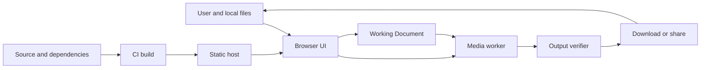

# Privacy Canvas Threat Model

## Executive summary

Privacy Canvas will process attacker-controlled image containers containing highly sensitive pixels and metadata inside an internet-delivered browser application. The highest risks are media exfiltration through DOM or supply-chain compromise, incorrect redaction or coordinate handling that exposes covered pixels, incomplete metadata sanitization, and parser or decode resource exhaustion. The repository is currently a foundation scaffold: controls documented in architecture and ADRs are design requirements unless an implementation or deployment configuration is cited explicitly.

## Scope and assumptions

- In scope: the browser/PWA runtime, local file intake, media worker, Working Document, rendering, encoding, verification, file download/share adapters, static asset caching, production response headers, CI, dependencies, and release artifacts.
- In-scope paths: `src/`, `public/`, `tests/`, `.github/`, `package.json`, `package-lock.json`, `docs/`, `CONTEXT.md`, `PRIVACY.md`, and `SECURITY.md`.
- Deployment: public static HTTPS application plus downloadable offline artifacts; no backend, accounts, authentication, authorization, or multi-tenancy.
- Data sensitivity: Source Media may identify at-risk people, locations, devices, and events. Disclosure can create physical, legal, employment, or reputational harm.
- Initial release: JPEG, PNG, and WebP; manual opaque redaction; no automatic detection, camera, video, document, or persistent project storage.
- Out of scope: compromise of the browser, extension, operating system, firmware, local filesystem, or destination platform; complete contextual anonymity; and guaranteed secure memory erasure.

Open questions that may change risk ranking:

- The production static host is not selected; header support, access-log handling, and artifact deployment controls must be verified before launch.
- Real-device memory and megapixel budgets are not yet measured.
- Any future detector or WASM codec introduces model/runtime assets and may require changes to the current no-connectivity policy.

## Implemented security test evidence

The synthetic corpus in `tests/fixtures/jpeg/` now provides committed inputs for TM-001, TM-003, and TM-005. Its 17 generated fixtures cover hostile filename and metadata text, EXIF/GPS/XMP/IPTC, an embedded thumbnail, camera and creator identity, timestamps, editing history, C2PA/JUMBF provenance, EXIF orientations 1–8, magic-byte mismatch, animation, truncation, malformed dimensions, oversized declared dimensions, and trailing data. `scripts/verify-fixture-corpus.mjs` independently checks corpus completeness, SHA-256 digests, structural signatures, declared dimensions, orientations, and required risk coverage through `npm run check`.

These fixtures are test evidence, not runtime mitigations. Intake limits, parsing, text-only rendering, worker isolation, fresh encoding, and output verification remain unimplemented until later tracer-bullet slices provide cited controls.

## System model

### Primary components

- **UI module:** current React shell and future workflow controls. It must not interpret untrusted metadata as markup (`src/App.tsx`, `CONTEXT.md` invariant 7).
- **Working Document module:** owns canonical geometry, transforms, operation history, and Confirmed Redactions. The first opacity/geometry invariant is implemented in `src/document/redaction.ts`.
- **Media worker:** planned owner of Source Media parsing, normalized pixels, full-resolution rendering, encoding, and verification (`docs/architecture.md`, “Data lifecycle”).
- **Viewport module:** planned pointer, keyboard, pan, zoom, and coordinate conversion logic (`docs/architecture.md`, “Viewport module”).
- **Platform adapters:** planned file download and native sharing paths that receive verified output only (`docs/architecture.md`, “Platform module”).
- **PWA/static host:** serves versioned application assets over HTTPS. Production header intent is captured in `public/_headers`.
- **CI/release pipeline:** installs exact dependencies, runs checks, and will publish static artifacts (`package.json`, `.github/workflows/ci.yml`).

### Data flows and trust boundaries

- **User filesystem → UI:** Source Media and filenames cross through browser file selection as local `File` objects. No authentication applies. Planned intake validates magic bytes, format, dimensions, frames, and resource limits before full decode (`docs/product-requirements.md`, Implementation Decisions).
- **UI → media worker:** Source Media bytes and typed operation messages cross browser structured-clone/transfer channels. Planned message schemas and stage errors are described in `docs/architecture.md`; runtime schema enforcement is not implemented.
- **Media worker → UI:** metadata risk categories, status, errors, and reduced preview frames cross worker messages. Metadata is required to remain text and previews must not be exportable (`CONTEXT.md` invariants 3 and 7).
- **Working Document → renderer/verifier:** transforms and Confirmed Redactions cross an internal typed interface. Normalized coordinate and opacity checks exist for rectangles (`src/document/redaction.ts`); full transform and renderer checks are not implemented.
- **Verifier → platform adapter → user filesystem/share target:** a verified output Blob and safe filename cross browser download or share mechanisms after user activation. Save/share gating is planned but not implemented (`docs/product-requirements.md`, stories 28–31).
- **Static host → browser:** application code, styles, workers, and future codecs cross HTTPS. There is no user authentication. CSP and related response headers are specified in `public/_headers`; host enforcement remains unverified.
- **Repository/dependency registry → CI → release:** source, npm packages, workflow actions, and build artifacts cross developer-controlled and third-party supply-chain boundaries. Exact package versions are declared in `package.json`; lockfile and pinned workflow actions provide reproducibility controls.

#### Diagram

## Assets and security objectives

| Asset                                  | Why it matters                                                                 | Security objective (C/I/A) |
| -------------------------------------- | ------------------------------------------------------------------------------ | -------------------------- |
| Source Media pixels                    | May identify at-risk people and locations                                      | C, I                       |
| Source metadata                        | May expose GPS, device identity, time, creator, editing history, or provenance | C, I                       |
| Working Document                       | Determines which pixels are transformed and covered                            | C, I, A                    |
| Confirmed Redactions                   | Failure or alteration can expose information the reviewer believed covered     | I                          |
| Privacy Export                         | This is the artifact users trust and distribute                                | I, C                       |
| Verification Report                    | Incorrect success creates dangerous confidence                                 | I                          |
| Application and worker code            | Compromise can exfiltrate media or falsify verification                        | I                          |
| Codec, parser, and future model assets | Process attacker-controlled data and affect rendered output                    | I, A                       |
| Service worker cache                   | Can retain a stale or compromised runtime across sessions                      | I, A                       |
| Build workflow and release artifacts   | A compromise affects every user of a published release                         | I                          |
| Device compute and memory              | Image bombs can freeze or terminate the editing session                        | A                          |

## Attacker model

### Capabilities

- Provide a user with a crafted image, filename, metadata block, color profile, dimensions, or malformed container that the user then selects.
- Control image pixels and contextual visual information.
- Operate a hostile network during the user's first public application load, subject to HTTPS guarantees.
- Attempt dependency, package-registry, contributor-account, workflow, or static-host compromise.
- Trigger repeated local operations and oversized workloads within browser limits.
- Analyze a distributed Privacy Export for surviving metadata or visual information.

### Non-capabilities

- No assumed code execution in an uncompromised browser or operating system before exploitation.
- No direct server upload endpoint, account, session, database, or cross-tenant state exists.
- No assumed physical access to the user's unlocked device.
- Browser extensions, OS screenshots, swap, filesystem recovery, destination platforms, and social inference from unredacted context are outside the product's enforceable controls.

## Entry points and attack surfaces

| Surface                       | How reached                                               | Trust boundary                     | Notes                                                      | Evidence (repo path / symbol)                   |
| ----------------------------- | --------------------------------------------------------- | ---------------------------------- | ---------------------------------------------------------- | ----------------------------------------------- |
| Local image selection         | User chooses an attacker-controlled file                  | Filesystem → browser               | Planned JPEG/PNG/WebP input; SVG and animation rejected    | `docs/product-requirements.md`, stories 1–3     |
| Filename and metadata display | Parsed source values are shown to the user                | Media worker → UI                  | Must use text nodes/properties only                        | `CONTEXT.md`, invariant 7                       |
| Image container and decoder   | Intake parses headers and decodes pixels                  | Untrusted bytes → media worker     | Resource limits and malformed inputs are security critical | `docs/architecture.md`, Intake module           |
| Edit operations               | Pointer/keyboard actions create transforms and redactions | UI → Working Document              | Coordinate mistakes can expose pixels                      | `src/document/redaction.ts`, `confirmRectangle` |
| Export encoder                | Canonical pixels become PNG/JPEG/WebP bytes               | Renderer → encoder                 | Must not copy source segments                              | `CONTEXT.md`, invariant 4                       |
| Output verifier               | Encoded bytes are classified as pass/fail                 | Encoder → verifier                 | A false success is integrity critical                      | `docs/architecture.md`, Verifier module         |
| Download/share                | Verified Blob leaves the application                      | Browser → external target          | Requires verification and user activation                  | `docs/product-requirements.md`, stories 28–31   |
| Static asset loading          | Public browser requests the release                       | Internet/static host → browser     | No auth; headers and release integrity matter              | `public/_headers`                               |
| Service worker/update path    | Browser installs or updates cached runtime                | Static host → browser cache        | Planned; stale/poisoned releases may persist               | `docs/adr/0006-offline-asset-cache-only.md`     |
| npm and CI                    | Maintainer or automation installs and builds              | Third parties/repository → release | Exact versions and pinned actions reduce drift             | `package.json`, `.github/workflows/ci.yml`      |

## Top abuse paths

1. **Exfiltrate Source Media through DOM injection:** attacker embeds executable markup in a filename or metadata field → UI interprets it as markup → script reads preview pixels or file references → script transmits data → at-risk people are exposed.
2. **Publish a compromised release:** attacker compromises a dependency, workflow, maintainer token, or static host → malicious code ships under the trusted origin → user opens Source Media → code exfiltrates it or falsifies verification.
3. **Recover pixels from an incorrect mask:** coordinate conversion or transform ordering diverges between preview and export → reviewer sees a covered region → full-resolution export places the mask elsewhere or leaves transparent pixels → recipient recovers the intended secret.
4. **Retain sensitive metadata:** encoder copies source chunks or verifier overlooks a format-specific segment → verification reports success → GPS, thumbnail, C2PA, XMP, or device data survives distribution.
5. **Exhaust device resources:** crafted dimensions, frame count, profile, or compressed content passes superficial file-size checks → decoder allocates excessive memory or CPU → tab or device becomes unavailable during urgent use.
6. **Persist original media accidentally:** implementation places File, Blob, preview, or Working Document data in Cache Storage or IndexedDB → another session or local user retrieves it → confidentiality is lost after the user believed the session ended.
7. **Keep users on a vulnerable cached release:** service worker update handling serves a stale or compromised application indefinitely → fixed security defects do not reach users → later Source Media is processed by known-vulnerable code.
8. **Mislead users about privacy or provenance:** UI describes suggestions as complete or labels an unverified/metadata-altering output safe → user discards provenance or shares an incompletely reviewed image → physical, legal, or evidentiary harm follows.

## Threat model table

| Threat ID | Threat source                                        | Prerequisites                                                                   | Threat action                                                                                  | Impact                                                                          | Impacted assets                                           | Existing controls (evidence)                                                                                        | Gaps                                                                        | Recommended mitigations                                                                                                                                            | Detection ideas                                                                                       | Likelihood | Impact severity | Priority |
| --------- | ---------------------------------------------------- | ------------------------------------------------------------------------------- | ---------------------------------------------------------------------------------------------- | ------------------------------------------------------------------------------- | --------------------------------------------------------- | ------------------------------------------------------------------------------------------------------------------- | --------------------------------------------------------------------------- | ------------------------------------------------------------------------------------------------------------------------------------------------------------------ | ----------------------------------------------------------------------------------------------------- | ---------- | --------------- | -------- |
| TM-001    | Crafted filename or metadata                         | User selects attacker-influenced Source Media and the UI displays source values | Inject markup/script into a DOM sink and exfiltrate media                                      | Disclosure of highly sensitive pixels and metadata                              | Source Media, metadata, Privacy Export                    | CSP/Trusted Types intent in `public/_headers`; text-only invariant in `CONTEXT.md`                                  | Metadata UI and Trusted Types browser tests do not exist                    | Ban dynamic HTML sinks in lint/review; render source values with text properties; enforce Trusted Types; test hostile payload fixtures                             | Browser tests that inject tags/event handlers and fail on any request                                 | Medium     | High            | High     |
| TM-002    | Supply-chain or release attacker                     | Compromise of dependency, action, maintainer account, build, or host            | Ship code that reads media, weakens checks, or falsifies output                                | Systemic disclosure or unsafe exports across users                              | Application code, releases, Source Media                  | Exact versions in `package.json`; pinned actions planned in CI; Apache notices                                      | No signed release, SBOM, protected environment, or artifact attestation yet | Minimal dependencies; npm provenance review; SHA-pin actions; CodeQL/dependency review; SBOM; artifact attestations; protected releases; reproducible build checks | Dependency diffs, release hash comparison, workflow audit, build provenance verification              | Medium     | High            | Critical |
| TM-003    | Crafted or unusually large image                     | File passes initial selection and reaches parser/decoder                        | Trigger excessive allocation, CPU, parser bug, or worker crash                                 | Loss of availability; possible decoder exploitation within browser/WASM context | Device compute, media worker, session                     | Planned pre-decode limits in `docs/architecture.md`; unsupported formats scoped out                                 | Limits and worker isolation are not implemented or measured                 | Sniff dimensions/frames before decode; hard byte/pixel/time budgets; worker termination; reject animation; fuzz intake; test malformed corpus                      | Resource telemetry kept in-memory, timeout tests, crash/failure-rate testing                          | High       | Medium          | High     |
| TM-004    | Implementation defect or malicious edit state        | Preview/export transform, geometry, alpha, or ordering differs                  | Produce an export that leaves a Confirmed Redaction incomplete or misplaced                    | Pixels the reviewer believed hidden become visible                              | Confirmed Redactions, Privacy Export                      | Opaque normalized rectangle invariant in `src/document/redaction.ts`; canonical-coordinate decision in architecture | Renderer, transform, lossy-output, and full-resolution checks do not exist  | Single Working Document semantics; opaque types; safety margin; render goldens; decode final output and verify mask coverage; block on mismatch                    | Pixel-diff and property tests across transforms, dimensions, alpha, and formats                       | Medium     | High            | Critical |
| TM-005    | Encoder/verifier defect or unknown metadata layout   | Source contains a supported or unusual metadata segment                         | Carry EXIF/GPS/XMP/IPTC/thumbnail/profile/C2PA data into output or miss it during verification | Location, identity, device, or provenance disclosure                            | Source metadata, Privacy Export, Verification Report      | Fresh-encoding invariant in `CONTEXT.md`; strict verifier design in architecture                                    | Encoders and independent runtime/CI verifiers are not implemented           | Never copy source chunks; format-specific allowlists; fail on unknown ancillary chunks; cross-check with ExifTool and C2PA tools; contaminated fixtures            | CI scans every golden export and negative fixture; runtime verification failures counted locally only | Medium     | High            | Critical |
| TM-006    | Implementation defect or future feature              | Code uses browser persistence for convenience or recovery                       | Persist Source Media, previews, metadata values, or Working Documents                          | Sensitive data survives session or becomes accessible to another local user     | Source Media, metadata, Working Document                  | No-media-persistence invariant and privacy policy; current shell has no storage calls                               | No automated storage audit or lifecycle implementation                      | Keep persistence adapter asset-only; revoke URLs; close bitmaps; terminate workers; browser tests inspect Cache/IndexedDB/storage after workflows                  | E2E storage snapshots before/after session and reset                                                  | Medium     | High            | High     |
| TM-007    | Host/cache/update attacker or flawed release process | PWA caching is implemented and users rely on offline copies                     | Serve stale, mixed-version, or poisoned assets                                                 | Known vulnerabilities persist or module versions disagree                       | Service worker cache, application code, availability      | Asset-only cache ADR; versioned-release intent                                                                      | No service worker, update protocol, rollback policy, or offline tests yet   | Generated precache manifest; atomic versioned cache; explicit update UI; delete old caches; no user media caching; offline and mixed-version tests                 | Release smoke test, cache inventory assertions, version displayed in app                              | Medium     | Medium          | Medium   |
| TM-008    | Product language or future detector                  | User over-trusts automation or sanitization claims                              | Treat suggestions as complete, discard provenance, or infer anonymity                          | Physical, legal, reputational, or evidentiary harm                              | User safety, Source Media provenance, Verification Report | Honest terminology in `CONTEXT.md`; v1 excludes detection; warnings in README/PRD                                   | Usability review and provenance warning are not implemented                 | Human confirmation; final contextual checklist; separate “verified file properties” from “not guaranteed”; explicit C2PA/rights warning                            | Content review, usability testing with target users, detector miss-rate reporting in future           | Medium     | High            | High     |

## Criticality calibration

- **Critical:** plausible systemic compromise or a defect that makes a core privacy guarantee false with severe user harm. Examples: a published release exfiltrates Source Media; confirmed masks systematically render at wrong coordinates; supported exports pass verification while retaining GPS/C2PA data.
- **High:** targeted disclosure, likely denial of urgent use, or misleading safety behaviour requiring a crafted file or feature path. Examples: metadata DOM injection; image bombs that repeatedly crash mid-range devices; media accidentally persisted across sessions.
- **Medium:** meaningful integrity or availability loss with visible symptoms, narrower scope, or straightforward recovery. Examples: a stale service-worker cache delays a fix; unsupported browser sharing loses the output without exposing the source; a malformed file terminates only its worker cleanly.
- **Low:** low-sensitivity or cosmetic issues without violation of a privacy invariant. Examples: an incorrect non-sensitive file-size estimate; a recoverable theme preference failure; a rejected unsupported image with a poor error message.

Risk rankings assume high data sensitivity, public internet delivery, no server-side media path, manual-only v1, and an otherwise uncompromised browser/OS. Adding remote models, a backend, persistent projects, plugins, automatic confirmation, or native wrappers requires re-ranking.

## Focus paths for security review

| Path                                   | Why it matters                                                                      | Related Threat IDs     |
| -------------------------------------- | ----------------------------------------------------------------------------------- | ---------------------- |
| `src/document/`                        | Defines redaction geometry, opacity, transforms, and edit invariants                | TM-004, TM-008         |
| `src/intake/`                          | Will parse attacker-controlled containers and enforce resource budgets              | TM-001, TM-003, TM-005 |
| `src/workers/`                         | Will own sensitive bytes, isolation, message validation, and cleanup                | TM-003, TM-006         |
| `src/renderer/`                        | Will determine whether confirmed regions are actually replaced                      | TM-004                 |
| `src/sanitizer/`                       | Will coordinate fresh encoding without source segment copying                       | TM-004, TM-005         |
| `src/verifier/`                        | A false success directly breaks the product promise                                 | TM-004, TM-005, TM-008 |
| `src/platform/`                        | Will gate verified output across download/share seams                               | TM-005, TM-008         |
| `src/ui/`                              | Will display untrusted metadata and communicate safety limitations                  | TM-001, TM-008         |
| `public/_headers`                      | Defines production browser restrictions against injection and egress                | TM-001, TM-002         |
| `public/`                              | Future service worker, manifest, codecs, and cached assets affect offline integrity | TM-002, TM-007         |
| `.github/workflows/`                   | Build and release compromise has systemic impact                                    | TM-002                 |
| `package.json` and `package-lock.json` | Dependency integrity and scripts define the build surface                           | TM-002                 |
| `tests/fixtures/`                      | Must represent hostile metadata, malformed containers, and negative outputs         | TM-001, TM-003, TM-005 |
| `tests/browser/`                       | Must prove no egress, no persistence, offline behaviour, and export gating          | TM-001, TM-006, TM-007 |

## Quality check

- [x] Covered all currently discovered and planned v1 entry points.
- [x] Represented each filesystem, worker, export, host, cache, and supply-chain trust boundary in at least one threat.
- [x] Separated browser runtime from CI/build/release behaviour.
- [x] Reflected confirmed context: public PWA, downloadable release, no backend/auth, high-sensitivity media, manual v1.
- [x] Marked planned controls separately from implemented scaffold controls.
- [x] Listed assumptions and open questions that can change priorities.
